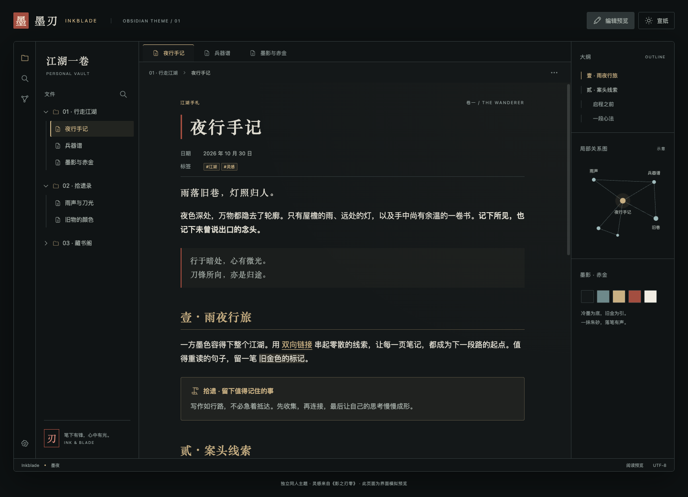
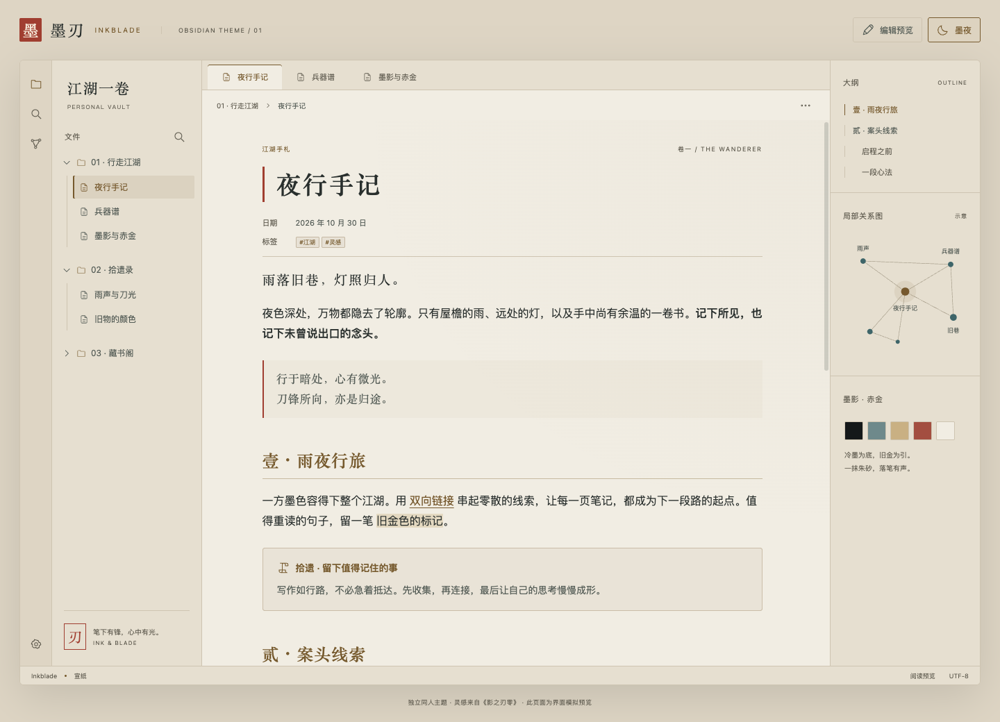

# 墨刃 · Inkblade

**墨影为底，赤金为引。** 一款受《影之刃零》暗黑武侠氛围启发的 Obsidian 主题。

Ink-black surfaces, aged brass, cool steel and a touch of vermilion. An independent, offline-first Obsidian theme with dark and light modes.





## 设计

- **墨夜**：冷墨黑 `#141819` 作底，灰白 `#DEDBD0` 写字；旧金 `#C9B083` 用于标题和导航，冷青 `#9FBABB` 用于外链与行内代码，朱砂只落在重点。
- **宣纸**：纸白 `#F1EDE3` 作底，浓墨 `#292F2D` 写字；古铜 `#765A2E`、青灰 `#3E6569`、朱砂 `#A03E30` 分别承担对应角色。配色是独立设计，并非游戏官方色板。
- **排版**：标题使用系统宋体／衬线字体，正文使用系统无衬线字体；正文默认遵循 Obsidian 的字号设置，行高 1.8，可读栏宽 45rem。圆角克制，细线分层。
- **界面**：文件树选中项的一道金边、活动标签页顶部的细线、标题旁的朱砂边线，延续同一套视觉语言。

覆盖阅读视图、Live Preview 与源码编辑器、属性、文件树、链接、标签、引用、任务、代码、表格、搜索与弹窗，并为关系图和 Canvas 提供配色变量。移动端保留原生布局和触摸控件；打印时切换为白底深色文字。

主题不加载网络字体、图片或脚本，不需要 Style Settings。原生外观设置仍可调整正文／界面字体、字号、强调色及可读栏宽。自定义强调色后，请自行确认按钮文字对比度。

## 安装

需要 **Obsidian 1.10.6 或更高版本**。本目录中的 `Inkblade-1.0.0.zip` 是手动安装包，尚未发布到社区主题市场。

1. 将 ZIP 解压到你的库的 `.obsidian/themes/`，得到：

   ```text
   .obsidian/themes/Inkblade/
   ├── manifest.json
   ├── theme.css
   └── LICENSE
   ```

2. 打开 **设置 → 外观 → 主题**，选择 **Inkblade**。如列表未刷新，重新打开 Obsidian。
3. 在 **基础配色** 中选择深色或浅色。

也可以直接从当前工作目录复制两个必需文件，先替换下面的库路径：

```sh
mkdir -p "/你的库/.obsidian/themes/Inkblade"
cp obsidian-inkblade-theme/manifest.json obsidian-inkblade-theme/theme.css "/你的库/.obsidian/themes/Inkblade/"
```

安装后的文件夹名称必须是 **Inkblade**，与 `manifest.json` 中的 `name` 完全一致。源码目录 `obsidian-inkblade-theme` 不需要改名。

## 提示块与示例笔记

除 Obsidian 默认提示块外，还提供两种可选类型：

```md
> [!scroll] 拾遗 · 留下值得记住的事
> 写作如行路，不必急着抵达。

> [!blade] 醒刃 · 勿忘来路
> 锋芒留给重点，宁静留给文字。
```

将 [examples/夜行手记.md](examples/夜行手记.md) 复制到自己的库中，即可检查真实应用内的标题、提示块、表格、任务与代码样式。示例文案为原创，不包含游戏剧透。

## 本地预览

直接用浏览器打开 [preview/index.html](preview/index.html)。也可在当前工作目录运行：

```sh
python3 -m http.server 8765 --bind 127.0.0.1
```

访问 `http://127.0.0.1:8765/obsidian-inkblade-theme/preview/index.html`，使用右上角按钮切换深浅色和编辑样式。预览支持示例笔记切换、标题搜索、字号调整、任务勾选和移动端文件抽屉。`Ctrl/Cmd + P` 打开示例搜索，标签页支持方向键切换。

预览是浏览器中的界面模拟，配色与装饰直接引用 `theme.css`；编辑示例不执行 Markdown 解析或保存，关系图为静态示意。真实 Obsidian 会根据你的系统字体、插件、窗口大小与设置呈现界面。截图不是游戏截图，也不是 Obsidian 实机截图。

## 验证与边界

默认配置下，正文与背景的 WCAG 对比度：

| 组合 | 墨夜 | 宣纸 |
| --- | --- | --- |
| 正文／主背景 | 12.90 : 1 | 11.67 : 1 |
| 次级文字／主背景 | 8.03 : 1 | 6.00 : 1 |
| 内链／主背景 | 8.53 : 1 | 5.55 : 1 |
| 外链／主背景 | 8.70 : 1 | 5.49 : 1 |
| 主按钮文字／按钮背景 | 8.53 : 1 | 6.19 : 1 |

以上是默认颜色组合的检查结果，并非对任意插件和自定义片段的完整无障碍认证。

- Chromium 中检查了深浅色、编辑／阅读切换、搜索及空结果、任务状态、设置弹窗、键盘标签切换；320px、390px、1440px 窗口没有页面横向溢出。
- 使用本机 **Obsidian 1.12.4 的原生 `app.css`**，在隔离浏览器样例中核对了标题、编辑标题、内外链、按钮与自定义提示块的计算样式。该基础样式仅用于本地检查，不随主题分发。
- 另行检查了原生删除确认按钮、成功／错误消息、冲突快捷键与错误提示，默认深浅色下文字对比度均超过 6 : 1；打印配色也已核对。
- 尚未在 Obsidian 实机、iOS／Android 或所有第三方插件组合中逐项验收。移动端截图仍是浏览器模拟。
- 标题字体依赖系统可用字体；没有宋体／思源宋体时，会回落到其他衬线字体。主题不附带游戏美术、Logo 或商业字体。

## 开发依据

结构参考当前工作区的 `obsidian-morandi-theme`，将颜色优先映射到 Obsidian 原生变量，保留原生布局。没有运行时依赖或构建步骤；实际安装只需要 `manifest.json` 与 `theme.css`。

- [Obsidian：Build a theme](https://docs.obsidian.md/Themes/App%20themes/Build%20a%20theme)
- [Obsidian：Theme guidelines](https://docs.obsidian.md/Themes/App%20themes/Theme%20guidelines)
- [Obsidian：Colors](https://docs.obsidian.md/Reference/CSS%20variables/Foundations/Colors)
- [《影之刃零》官网](https://pbz.s-game.com/)
- [PlayStation 官方游戏介绍与视觉素材](https://www.playstation.com/zh-hans-cn/games/phantom-blade-zero/)

代码仓库：[xwtaidev/obsidian-inkblade-theme](https://github.com/xwtaidev/obsidian-inkblade-theme)。`manifest.json`、`theme.css`、截图与许可证均位于仓库根目录。

与 Morandi 一样，仓库通过 GitHub Actions 自动发布版本：更新 `manifest.json` 后，推送与 `version` 完全相同的标签（例如 `1.0.0`，不带 `v` 前缀），会生成包含 `manifest.json` 和 `theme.css` 的 Release。工作流会先检查标签与版本号是否一致。

目前尚未发布 Release 或提交社区主题市场审核。后续可按 [Submit your theme](https://docs.obsidian.md/Themes/App%20themes/Submit%20your%20theme) 提交社区主题。

本主题为独立同人作品，与 S-GAME 及《影之刃零》官方无隶属或授权关系。游戏名称及商标归各自权利人所有。原创主题代码使用 [MIT](LICENSE) 许可证。
